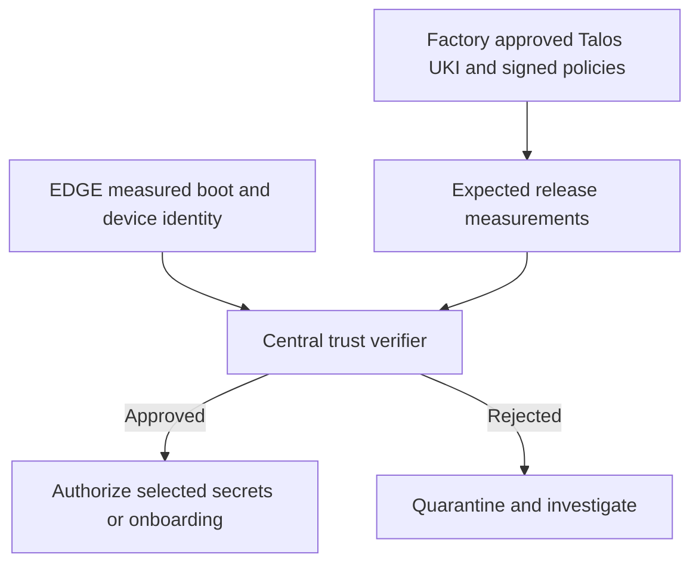

# UKI, Secure Boot and PCR

**Status:** Concepts concluded; practical enforcement tests pending.

## Three separate roles

| Concept | Meaning |
| --- | --- |
| UKI | Unified Kernel Image: an EFI executable packaging kernel, initramfs and boot arguments |
| Secure Boot | Signature enforcement along the firmware and boot chain against enrolled public trust |
| PCR | Platform Configuration Register in the TPM, accumulating hashes of measured events |

PCRs record measurements; they do not independently decide whether software is good. A verifier or disk-unlock policy evaluates those measurements. The discussed Talos policy uses PCR 7 for Secure Boot-related state and signed PCR 11 policies for UKI/boot phases; exact configuration must follow the selected release.

## Shared build and individual use

1. NEN prepares signing keys and approved image inputs without requiring EDGEs.
2. The build workflow assembles and signs the bootloader/UKI and publishes matching ISO/PXE and installer artifacts.
3. Each EDGE receives authorized public UEFI trust through the factory procedure.
4. Installation writes approved Talos and signed boot components onto that EDGE's SSD.
5. Subsequent boots verify executable components again. The complete ISO is not what UEFI signature-checks.
6. If configured and validated, TPM-backed disk encryption releases key material under its policy.

Identity Root/Issuing CAs, boot signing keys and PCR policy signing keys have separate roles. An EDGE identity certificate does not by itself authorize UKI execution.

**TODO:<Question>** Validate measured boot, policy updates and recovery on the selected firmware/TPM profile.

References: [Talos Secure Boot](https://docs.siderolabs.com/talos/v1.14/platform-specific-installations/bare-metal-platforms/secureboot), [disk encryption](https://docs.siderolabs.com/talos/v1.14/configure-your-talos-cluster/storage-and-disk-management/disk-encryption).

## Connection to AWS CMP317 attestation learning (2026-10-18)

The [CMP317 attestation guide](https://github.com/naren4b/learn-aws/tree/docs/cmp317-attestation-learning/docs/attestation) adds SHA-256 measurement, signed evidence, nonce, a policy verifier and a local simulated key-release lab. The [PCR catalog](https://github.com/naren4b/learn-aws/blob/docs/cmp317-attestation-learning/docs/attestation/pcr-reference.md) lists PCR0-23, measurement writers, readers and OS differences.

For 1,000 EDGEs, potential extension:

**Scope boundary:** Talos TPM-bound disk encryption is not automatically a fleet remote-attestation service. A real implementation still needs trustworthy event/quote evidence, device identity, nonce validation, certificate chains, provisioning, revocation, PCR policy lifecycle, offline recovery, and a fleet decision service. AWS NitroTPM PCR semantics must not be assumed identical to physical Talos TPMs. This remains a planned lab/architecture extension, not implemented fleet enforcement.

